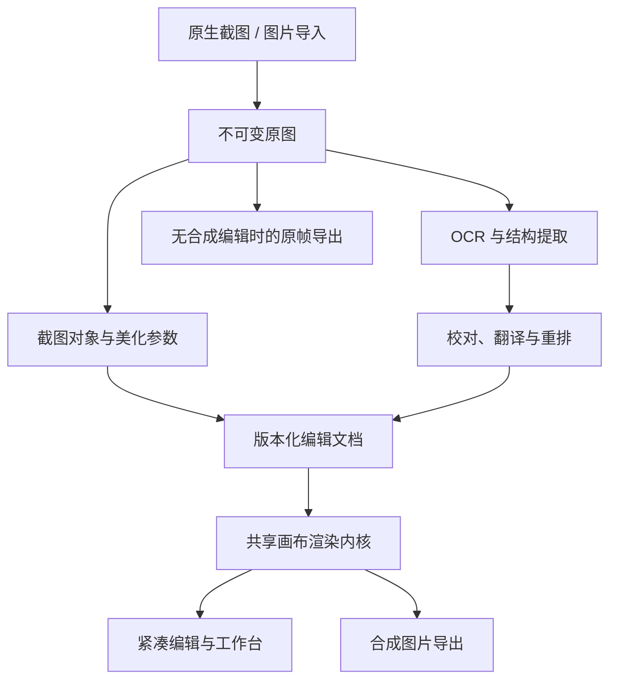

# 评估截图软件方案：完整正文归档

来源：[评估截图软件方案](https://chatgpt.com/c/6ad5a272-2bac-83ec-ae77-eec26736aaff)。本地缓存预览首先通过官方任务接口取得；完整助手正文随后由协调端使用受支持的 `global_search.read_conversation_context` 读取并转交（助手消息 `fe1ad7e6-490f-5342-a0c7-3603e841dfb5`，协调端核验 next_cursor=null、content_omitted=false）。正文中的引用标记不可单独解析为来源链接；下文保留评估内容，不把其未重新核验的时效性陈述当成本次实测事实。格式仅整理换行、转义字符与不可解析的引用标记。

## user

我想做一个windows的截图软件，你先评估一下截图软件该有的功能，我希望界面和截图成品美观，截图不需要完全还原被截内容，可以给被截图内容增加圆角，对文本内容重新布局等，当然，也可以照实截图，另外还需要对接各种ai的接口进行OCR和翻译。需要你进行技术栈、实现方式、功能、前端的评估，评估要全面。

## assistant

**技术上可行。我建议把它定位成一款“Windows 截图与内容美化工具”：既能快速输出原始截图，也能把截图中的文字、图片片段和结构重新组织成更好看的成品。**

针对你提出的重点，我目前的主推荐是：

> **C# / .NET 10 + WPF 原生宿主 + Windows 原生截图能力 + WebView2 中的 React / TypeScript 编辑器。**
> **编辑画布优先评估 Fabric.js，本地 OCR 以经过验证的 ONNX 模型为基础，AI 接口采用可扩展的服务商适配层。**

这里最值得投入的，是三个方面：

- **截图体验可靠**：快捷键响应、跨屏选区、复制粘贴、窗口截图都足够顺畅。
- **默认成品美观**：无需反复调整参数，就能获得比例、留白、圆角、文字层次都协调的图片。
- **内容重排可控**：识别出的文字能校对，版面能编辑，翻译能与原文对应，导出效果与预览一致。

下面按 **Windows 优先、个人或小团队开发、普通截图离线可用、AI 服务可由用户配置** 进行完整评估。涉及框架和平台能力的事实，依据截至 **2026 年 10 月 19 日** 的官方资料；技术优先级、工作量和性能目标属于我的工程判断，并非实测结果。

---

# 一、首先明确：原样、美化、重排，是三种不同的输出意图

这是整个产品最重要的定义，会直接影响界面、数据结构和实现成本。

| 模式 | 用户想得到什么 | 软件实际做什么 | 主要难度 |
|---|---|---|---|
| **原样截图** | 当前界面的真实画面，用于交流、反馈、留档 | 捕获像素，支持裁剪、标注、遮盖 | 多屏、DPI、颜色、窗口兼容性 |
| **美化截图** | 内容保持原有样子，但呈现更漂亮 | 圆角、留白、背景、阴影、边框、标题、拼图 | 比例与默认样式、高清导出 |
| **内容重排** | 把截图中的信息整理成新的版面 | 提取文字与图片片段，重建段落、列表、卡片等 | OCR、结构识别、文本排版、校对 |

**翻译应该作为可叠加的能力，作用于这些模式，而不是单独形成另一套编辑器。**

例如，同一张英文技术文档截图，可以得到：

1. 原始截图，加一个箭头。
2. 保留原图，加圆角和背景。
3. 提取文字，重新排成中文阅读卡片。
4. 原文与译文上下对照的双语图片。
5. 在原图文字位置覆盖译文。

这五种结果可以共享原始素材，但应保留各自的编辑结果。

## 需要进一步区分“圆角”的两种含义

你说的“给被截图内容增加圆角”，至少涉及两类功能：

**整张截图增加圆角**，比较简单。把原图放进圆角裁切区域，再添加背景和阴影即可。

**截图内部的某个面板、代码块、聊天气泡增加圆角**，就需要先把这个区域提取为独立对象，再进行裁切、摆放或重建。它已经接近局部内容编辑。

我建议两种都纳入产品设计，但实现顺序不同：先做整图美化，再做可选择的内部片段。

另外，圆角、美化和图内文字编辑已经存在于成熟工具中。ShareX 有专门的图片美化工具，Snagit 也提供识别截图元素后移动、移除，以及编辑图内文字的功能。因此，产品价值应建立在**工作流、成品质量和使用体验的组合**上。:chatgpt-content-reference{index="0"}

---

# 二、截图软件应具备的完整功能

我建议使用三档优先级：

- **P0：首个可日常使用版本必须具备。**
- **P1：核心体验稳定后优先扩展。**
- **P2：成本较高，或需要明确需求再投入。**

## 2.1 捕获与基础操作

| 功能 | 建议级别 | 具体要求 |
|---|---|---|
| 区域截图 | P0 | 鼠标框选、重新调整范围、尺寸显示、像素级微调 |
| 窗口截图 | P0 | 自动识别窗口范围，可选择包含标题栏或仅保留内容 |
| 全屏截图 | P0 | 当前显示器、指定显示器 |
| 多显示器 | P0 | 不同分辨率、不同缩放比例、副屏位于主屏左侧或上方 |
| 全局快捷键 | P0 | 可自定义、冲突提示、截图中防止重复触发 |
| 冻结画面 | P0 | 框选时保持截图底图稳定 |
| 图片导入 | P0 | 文件拖入、剪贴板粘贴、打开本地图片 |
| 鼠标指针显示 | P1 | 可选择是否包含指针 |
| 延时截图 | P1 | 方便截菜单、悬浮提示和临时状态 |
| 重复上次区域 | P1 | 固定位置反复截图 |
| 滚动长截图 | P1 | 先实现手动滚动拼接，再增加自动滚动 |
| 多区域截图 | P1 | 一次选择多个片段，合并到一张图片 |
| 控件或元素吸附 | P1/P2 | 除窗口外，还能选择内部面板或控件 |
| 连续截图、录屏、GIF | P2 | 会增加采集、编码、时间轴和资源管理工作 |

## 2.2 编辑、标注与美化

| 功能 | 建议级别 | 具体要求 |
|---|---|---|
| 裁剪、缩放 | P0 | 保持比例、明确最终像素尺寸 |
| 箭头、矩形、文字、高亮 | P0 | 默认样式统一，可修改颜色与粗细 |
| 实色遮盖 | P0 | 用于可靠地遮住敏感内容 |
| 撤销、重做 | P0 | 覆盖标注、美化、文本修改和应用 AI 结果 |
| 圆角 | P0 | 可关闭，可调整，避免误裁掉角落内容 |
| 留白、背景、阴影、边框 | P0 | 少量高质量预设，参数可微调 |
| 自定义样式预设 | P0 | 保存用户常用的成品风格 |
| 序号、自由画笔、椭圆 | P1 | 用于教程和说明 |
| 聚光、局部放大 | P1 | 突出截图中的重点 |
| 马赛克、模糊 | P1 | 作为视觉处理；敏感信息仍优先使用实色遮盖 |
| 多图排版 | P1 | 横排、竖排、网格、间距统一、对齐 |
| 局部片段提取 | P1 | 将截图中的面板、图片、代码块独立摆放 |
| 窗口外框、设备外框 | P1/P2 | 适合展示素材，可按目标用户决定优先级 |
| 透视、复杂特效、智能消除 | P2 | 成本与不确定性明显增加 |

## 2.3 OCR、翻译与内容重排

| 功能 | 建议级别 | 具体要求 |
|---|---|---|
| 本地 OCR | P0 | 不依赖云服务，也不要求用户安装 Python |
| 区域 OCR | P0 | 只识别用户选择的部分 |
| 识别结果校对 | P0 | 原图与文本可以对应查看、修改 |
| 复制文本 | P0 | 保留换行、合并断行两种方式 |
| 普通段落重排 | **P0** | 调整卡片宽度、字号、行距、段落间距 |
| 翻译 | P0 | 选择语言、复制译文、取消、失败重试 |
| 双语卡片 | **P0** | 原文与译文清晰对应 |
| 多 AI 服务配置 | P0 | 可配置接口、密钥、模型，并测试能力 |
| 标题、列表、引用块 | P1 | 增加结构层次 |
| 代码卡片 | P1 | 保留缩进、长行处理、可选语法高亮 |
| 简单表格重建 | P1 | 行列编辑、复制为表格数据 |
| 术语表 | P1 | 固定产品名、技术名词、专有名称 |
| 原位翻译 | P1/P2 | 处理背景覆盖与译文长度变化 |
| 任意界面自动重建 | P2 | 需要持续评估，不能预设通用成功率 |
| 视频、游戏持续翻译 | P2 | 属于实时采集与连续识别任务，复杂度不同 |

**首版一定要包含基础重排。**如果只做截图、圆角和 AI 识别按钮，就验证不到你最在意的“截图成品可以重新设计”这件事。

## 2.4 输出、历史与桌面辅助

| 功能 | 建议级别 | 具体要求 |
|---|---|---|
| 复制图片、保存 PNG | P0 | 最常用的输出路径 |
| 复制原文、复制译文 | P0 | 不强制生成图片 |
| 保存可编辑项目 | P0 | 能恢复原图、文字、标注和样式 |
| 最近截图与恢复 | P0 | 防止误关闭后丢失 |
| 缓存清理 | P0 | 有空间限制和清理入口 |
| 基础钉图 | P0/P1 | 置顶、缩放、关闭，适合对照资料 |
| 钉图透明度、点击穿透 | P1 | 增强桌面对照体验 |
| JPEG、WebP | P1 | 明确透明背景及压缩策略 |
| 长图分页 PDF | P1 | 适合长文字和双语内容 |
| OCR 文本搜索 | P1 | 从历史截图中检索内容 |
| 批量导出、批量套模板 | P1 | 同系列图片统一风格 |
| 云同步、分享链接、团队功能 | P2 | 需要额外账户、存储和服务端体系 |

---

# 三、桌面技术栈评估

## 3.1 主要候选方案

下面的适合程度是针对这个项目的判断，并非框架性能排行榜。

| 技术栈 | 适合之处 | 主要成本 | 我的判断 |
|---|---|---|---|
| **C# + WPF + WebView2 + React** | Windows 系统能力集中在 C#，复杂编辑界面可以使用 Web 技术 | 原生与前端通信、多窗口生命周期、图像传输 | **最符合当前需求的主方案** |
| **C# + WinUI 3 + 原生图形层** | 现代 Windows 控件、原生交互和视觉体系 | 画布编辑、复杂排版需要更多原生实现 | 适合决定全应用采用原生 UI 的情况 |
| **C# + 纯 WPF 编辑器** | 技术体系集中，桌面功能方便组织 | 高度定制的模板和文本编辑器需要较多自绘工作 | 可以做，但应先验证重排编辑体验 |
| **Tauri 2 + Rust + React** | 前端自由，原生核心可控，便于保留跨平台结构 | Rust、COM/WinRT、图形互操作学习成本 | **第二候选** |
| **Electron + React** | Web 开发体验完整，桌面 API 较齐全 | 浏览器运行时、多进程资源、精细捕获可能仍需原生模块 | 适合团队已熟悉 Electron，或先验证产品体验 |
| **Qt + C++ / QML** | 图形、自绘、窗口控制和跨平台能力完整 | C++、QML 与平台适配的综合成本 | 有 Qt 经验时很有竞争力 |
| **JavaFX + Windows 原生桥接** | 可以沿用 Java 语言经验 | 截图、GPU、窗口和系统功能需要较多桥接 | 对你而言，整体投入未必比学习 C# 更低 |

Tauri 在 Windows 上使用 WebView2，因此它减少自带浏览器引擎的分发需求，并不意味着运行时没有浏览器进程或内存开销。Electron 则采用明确的主进程、渲染进程等架构。两者的资源表现应使用真实截图负载比较。

Qt 也有现代的 `QScreenCapture` 能力，不能简单认为只有微软技术栈才能完成截图；真正的取舍在于你愿意承担哪套语言、图形与平台集成成本。

## 3.2 为什么我更推荐 C# 原生核心配 React

考虑到你有 Java 背景，我判断 C# 的语言、类型系统、异步调用和常规工程组织会比较容易衔接。这个项目更难的学习内容，是 Windows 的窗口、显示器、DPI 和图像资源管理。

采用这个组合，可以明确分工：

**C# 负责：**

- 全局快捷键、托盘和应用生命周期。
- 截图、显示器和窗口信息。
- 原生框选遮罩与放大镜。
- 剪贴板、文件保存、钉图。
- OCR 推理、网络请求、密钥管理。
- 本地数据库和任务管理。

**React 负责：**

- 紧凑标注窗口。
- 完整编辑工作台。
- 美化模板与属性面板。
- OCR 校对、翻译与重排。
- 历史记录和设置界面。

WPF 在这里主要是一个小型宿主。复杂编辑器集中在 React，能够控制两套 UI 同时扩张的风险。

WinUI 3 仍是值得考虑的现代原生方案，微软官方将其定位为 Windows 原生 UI 框架。如果最终决定整个编辑器都采用原生技术，我会提高它的优先级。

运行时建议从 **.NET 10 LTS** 开始。目前官方支持期到 **2028 年 11 月 14 日**；.NET 8 和 .NET 9 的支持都将在 2026 年 11 月结束。

---

# 四、整体架构：保留原图，建立可编辑文档

我建议使用**模块化的本地桌面架构**。截图、编辑、OCR、AI 和存储各有边界；暂时没有必要为本地功能建立服务器。

## 4.1 编辑工程不能只是一张最终 PNG

建议至少保存以下内容：

| 数据 | 作用 |
|---|---|
| 原始图像资产 | 保留原图，支持重新裁切和重新识别 |
| 捕获信息 | 像素尺寸、显示器、缩放、色彩信息、来源 |
| 图形对象 | 图片、箭头、文字、遮罩、背景、标题 |
| OCR 结果 | 原始文字、位置、阅读顺序、可用的置信信息 |
| 人工修订 | 用户修改后的文字，不覆盖原始识别结果 |
| 翻译结果 | 按原文块关联的译文、语言、服务商信息 |
| 布局规则 | 画布宽度、字号、间距、对齐和模板 |
| 文档修订号 | 撤销重做、自动保存、AI 结果合并 |
| 导出设置 | 格式、分辨率、透明背景、颜色策略 |

这样，更换圆角或阴影不需要重新 OCR；修改画布宽度不需要重新翻译；撤销一次 AI 结果也不需要再次付费调用。

**项目文件格式应该由应用自己定义，并带版本号。**Fabric 或 Konva 的对象序列化可以用于内部实现，但不宜直接作为长期产品格式。Konva 官方也建议 React 应用保存自身状态，而不是把画布对象树直接当成应用数据。

## 4.2 多窗口必须共享一份权威文档

紧凑编辑窗、完整工作台、OCR 面板不能各自维护一份互不一致的内容。

建议同一文档只允许一个编辑状态拥有者，其他窗口通过文档 ID 和命令访问它。钉图可以展示某个已生成版本，避免它与工作台相互覆盖。

AI 任务还需要绑定发起时的文档修订号：如果请求期间用户修改了文字，旧结果返回后应提示合并或重新应用，不能直接覆盖新内容。

---

# 五、Windows 截图底层应该怎样实现

## 5.1 主路径：Windows.Graphics.Capture

建议首先验证 **Windows.Graphics.Capture，简称 WGC**。

它可以获取显示器或应用窗口的图像帧。微软官方实现说明涉及 D3D11 帧池、窗口尺寸变化和设备资源生命周期。

具体使用方式：

- **区域截图**：获取相关显示器的图像，再按物理像素裁切。
- **窗口截图**：以窗口句柄创建捕获项。
- **全屏截图**：获取指定显示器图像。
- **框选冻结**：先获取底图，再显示自己的框选界面。
- **静态截图完成后**：停止不必要的连续采集。

桌面应用可以通过 `CreateForWindow(HWND)` 创建窗口捕获项，因此可以实现自己的窗口选择交互。系统选择器并非所有桌面场景下唯一的入口。

## 5.2 兼容路径：按实际问题增加

| 路线 | 建议定位 |
|---|---|
| WGC | 首先完成并验证的捕获后端 |
| DXGI Desktop Duplication | 出现具体兼容缺口，或需要高频桌面采集时增加 |
| GDI / BitBlt | 有限的传统屏幕位图兼容路径 |
| PrintWindow | 仅在明确场景中采用，并隔离阻塞风险 |

DXGI Desktop Duplication 需要处理显示器旋转和鼠标指针等细节；较新的 `DuplicateOutput1` 还支持协商更高色格式，不能笼统认为 DXGI 只能输出 8 位内容。

`PrintWindow` 由目标应用参与绘制，并且是可能阻塞的同步调用，不适合被当成捕获任意应用内容的通用办法。

**首版先抽象捕获后端，再完成一条可靠路径。**同时全面实现三套引擎，会增加大量兼容和测试工作。

## 5.3 多屏和 DPI 要从第一天处理

至少区分四种坐标：

1. 屏幕物理像素坐标。
2. 原生窗口的逻辑坐标。
3. WebView 中的 CSS 像素坐标。
4. 编辑文档坐标。

一台显示器 100%、另一台 150% 时，不能把某个统一缩放倍率套在整个桌面上。

建议采用 Per-Monitor V2，并验证：

- 100%、125%、150%、200% 缩放。
- 副屏位于主屏左侧，出现负坐标。
- 竖屏与横屏混用。
- 窗口在不同显示器之间移动。
- 显示器插拔、切换主屏。
- 框选、放大镜与最终裁切边界一致。

微软的高 DPI 文档明确说明了 DPI 感知模式和系统坐标虚拟化问题。这是截图软件必须专门验证的部分。

## 5.4 HDR 与“原样截图”的含义

HDR 显示器上的内容不能简单按普通 8 位图片处理，否则可能出现发白、过曝或颜色失真。WGC 官方建议考虑高色深捕获管线，再按需要做 HDR 到 SDR 的色调映射。

我建议首版的普通分享成品以 **SDR / sRGB** 为目标，并明确转换策略。这里的“原样”主要表示不自动改变布局、文字和视觉内容；跨显示设备的实际发光效果无法由一张普通图片完全复现。

## 5.5 滚动截图需要独立设计

建议按以下顺序实现：

1. **手动滚动 + 自动拼接。**
2. 在稳定场景中增加自动滚动。
3. 后续增加浏览器专用能力。

拼接算法需要处理重叠区域、固定表头、悬浮按钮、加载动画、重复内容和嵌套滚动区域。

自动滚动还存在权限边界。例如 Windows 的 `SendInput` 受完整性级别限制，能看到某个管理员应用，不代表普通进程能够向它注入滚动输入。

另外，WGC、DXGI 获取的是图像，不能直接返回 DOM、段落结构或尚未加载的列表内容。被遮挡、最小化、停止绘制的窗口，也应该在实际兼容测试后明确支持范围。

系统捕获边框和排除捕获窗口同样需要正确处理：WGC 关闭彩色捕获边框有授权与声明要求；自身工具窗口可以使用系统排除捕获能力，但需要验证目标系统上的行为。

---

# 六、美化与文本重排：建议分四个层级实现

## 6.1 第一层：整图美化

实现相对直接：

- 原图裁切。
- 圆角遮罩。
- 背景。
- 留白。
- 阴影与边框。
- 可选标题、来源。
- 导出尺寸。

真正影响体验的是默认规则。

例如，小截图应该使用较小留白；角落有重要文字时应降低圆角或增加内部留白；改变画布比例时应该调整外围布局，避免把截图拉伸变形。

**“一键美化”可以先依靠确定的设计规则实现。**调整圆角、间距和背景，不必每次请求 AI。

## 6.2 第二层：局部片段重新组合

这是很值得做的一层。

用户可以从截图中选出几个区域：

- 一个代码块。
- 一段聊天。
- 两个设置面板。
- 一张图表和对应说明。

把这些区域作为独立图片对象，重新排列、统一边距和圆角。

这一层无需识别并重新绘制所有文字，就能明显改善成品。它也适合处理原始界面比较杂乱、但用户只想分享其中几个部分的情况。

## 6.3 第三层：识别文字后重新排版

这才是你的主要特色功能。

推荐流程是：

**识别 → 校对 → 选择内容类型 → 应用排版规则 → 调整 → 导出。**

首版支持：

- 普通段落。
- 简单标题。
- 原文与译文对照。

后续增加：

- 列表。
- 代码块。
- 引用。
- 聊天消息。
- 简单表格。

例如，用户截取一段窄栏文章后，可以调整成更宽的阅读卡片。文字重新换行、卡片高度自动变化、字号保持可读，原来的网页侧栏和按钮不会进入成品。

这里需要严格区分：

- **格式整理**：恢复段落、合并视觉断行。
- **翻译**：转换语言。
- **改写**：润色、精简、总结。

用户点击“重新排版”时，默认只整理呈现方式。需要改写内容时，再使用明确的独立操作。

## 6.4 第四层：任意界面结构重建

例如，把一张复杂后台截图识别成标题、输入框、表格、按钮、图标，然后整体重新设计。

可以作为长期方向，但成本很高：

- 截图不包含原组件树。
- 字体、间距和层级可能只能推测。
- 小图标、复杂表格、图片背景容易识别不完整。
- 重建后的视觉和内容都需要用户检查。

我建议采用**按场景逐步支持**的方式。先把“文章”“代码”“聊天”“表格”中的一个做好，再扩大类型。

通用视觉模型也不适合作为精确坐标的唯一来源。OpenAI 与 Claude 的官方视觉文档都提到小字、图像缩放、位置估计和识别错误等限制。

---

# 七、OCR 技术方案

## 7.1 不应把 OCR 与大模型接口混成一件事

OCR 至少承担两类任务：

- **文字识别**：这张图上写了什么。
- **几何与结构识别**：文字在哪、先读哪块、哪些属于同一段。

大模型可以帮助理解上下文、识别内容类型、推测段落关系。但想让文字与原图对应，仍然需要可靠的位置和结构信息。

## 7.2 候选方案比较

| 方案 | 优点 | 限制与成本 | 建议定位 |
|---|---|---|---|
| **Windows.Media.Ocr** | 系统能力，部署较轻 | 应用身份、识别语言、图像尺寸等限制 | 条件满足时的轻量路线 |
| **Windows AI Text Recognition** | 新的系统文字识别能力 | 当前仍有明确硬件限制 | 可选增强 |
| **Paddle 系列模型 + ONNX Runtime** | 模型版本、语言和部署更可控 | 模型包、预处理、字典、后处理需要匹配 | **主要本地方案候选** |
| **专业云 OCR** | 可按接口获取文字位置与置信信息 | 网络、费用、上传数据 | 用户选择的增强路线 |
| **通用视觉语言模型** | 内容理解、结构推测、复杂语义 | 内容和坐标可能不准确 | 语义辅助与重试 |

这里有两个特别重要的现实限制：

**旧版 Windows OCR 存在 package identity 要求。**微软将相关 OCR 类列入需要应用身份的 API，因此普通便携 EXE 不能把它当成保证可用的唯一方案。

**新的 Windows AI OCR 目前也不能覆盖普通电脑。**官方硬件表仍将 OCR 标为支持 Copilot+ PC 的 NPU，GPU 和 CPU 路径均不支持。单纯有 RTX 显卡，不能据此判断可用。

## 7.3 我的实际建议

采用：

> **固定版本的本地 ONNX OCR 模型包作为稳定主路径；系统 OCR 在能力检测通过后作为可选路径。**

可以提供完整安装包和按需下载模型两种方式。CPU 推理先建立可交付基线，之后再评估硬件加速。

RapidOCR 是值得研究的工程基础，其官方项目以 PaddleOCR 模型转换和多语言部署为基础；ONNX Runtime 也有官方 C# 接入方式。但“有 C# 示例”不代表任意新模型都能直接替换，必须同时核实检测、识别、字典与前后处理。

复杂文档可进一步评估 PP-Structure，其处理范围包含布局和结构化文档信息。这部分适合在普通段落重排成熟后加入。

硬件加速也应根据当前路线评估。ONNX Runtime 官方已经说明 DirectML 进入持续维护阶段，Windows 新特性开发转向 WinML；因此首版以 CPU 为基线更容易控制部署范围。

## 7.4 OCR 数据不能只保存一段字符串

每个文字块至少应保存：

- 稳定 ID。
- 原始识别文本。
- 人工修订文本。
- 原图中的矩形或多边形。
- 阅读顺序。
- 识别引擎与模型版本。
- 可选置信度。
- 坐标来源：OCR 检测、模型估计或人工调整。

置信度必须允许缺失。旧版 `OcrWord` 公开的属性只有文字与边界，没有置信度属性。不同引擎的分数，也不宜直接当成统一的正确概率。

如果识别前进行了放大、切片、旋转或纠偏，还要保存坐标变换，确保结果能正确映射回原图。

---

# 八、多 AI 接口与翻译应该怎样设计

## 8.1 建立能力接口，再适配服务商

上层可以定义这些操作：

| 能力 | 输入 | 输出 |
|---|---|---|
| 文字识别 | 图片或区域 | 文字与可用的位置 |
| 布局分析 | 图片、OCR 块 | 内容类型、段落和顺序建议 |
| 分块翻译 | 带 ID 的原文块、目标语言 | 对应 ID 的译文 |
| 文本改写 | 用户选择的文字与指令 | 新文本 |
| 图片说明 | 图片 | 描述 |

底层再分别实现协议。

| 接口类型 | 需要处理的差异 |
|---|---|
| OpenAI 原生及兼容接口 | Chat Completions、Responses 的格式和能力差异 |
| Anthropic | 消息结构、图片内容块、请求头、流式事件 |
| Gemini | 原生接口与兼容接口的功能范围 |
| 百炼等兼容服务 | 端点、地域、模型与扩展参数 |
| 专业 OCR | 专用签名、接口版本、位置与置信度结构 |
| Ollama | 兼容子集、模型能力、加载状态、本地或云模型 |

Gemini、百炼和 Ollama 都有官方 OpenAI 兼容方案，但兼容程度及支持参数存在差异。因此“填写一个 Base URL 就兼容所有 AI”不能作为架构假设。

专业 OCR 的结果也需要独立适配。例如腾讯的高精度 OCR 接口会返回文字内容和文字框位置，并有其专用参数结构。

## 8.2 服务商设置应该具备什么

基础配置：

- 名称。
- 协议类型。
- API 地址。
- 密钥。
- 模型 ID。
- 必要的地域或专属端点。
- 超时、代理和高级参数。

能力检测：

- 测试连接。
- 获取模型列表。
- 测试文本请求。
- 测试图片请求。
- 测试结构化结果。

**模型能出现在列表中，不代表它支持看图、OCR 或结构化输出。**能力应记录到具体的“地址 + 模型 + API 类型”组合。

界面上可以直接显示：

- 可用于翻译。
- 支持图片输入。
- 可返回文字位置。
- 本地处理或云端处理。

这比简单显示“连接成功”更有用。

## 8.3 翻译要优先提供三种呈现

| 方式 | 体验 | 建议 |
|---|---|---|
| **旁边显示译文** | 原图保持可见，译文可复制 | 首版 |
| **双语重排** | 原文与译文上下或左右对应 | 首版 |
| **原位替换** | 译文覆盖到原文字位置 | 后续增强 |

原位替换的问题，不只是调用翻译接口。

英文变成中文，或中文变成英文后，文本长度和高度可能变化。建议排版顺序是：

1. 在允许宽度内换行。
2. 增加文字块高度。
3. 重排后续内容。
4. 在限定范围内微调字号和行距。
5. 仍然放不下时转为旁注或双语模式。

**不能静默截断，也不能一直缩小字号。**

对于纯色背景，可以覆盖原文字后重新绘制；渐变、照片和纹理背景则需要更复杂的修复。因此，双语重排通常更容易实现稳定、美观的结果。

## 8.4 任务管理和费用控制

建议从第一版就加入：

- 超时和取消。
- 区分认证错误、参数错误、限流和网络错误。
- 只重试失败的段落。
- 缓存 OCR 与翻译结果。
- 保存服务商返回的用量信息。
- 显示估算费用时明确标注“估算”。

改变背景、圆角、字体或间距，不应重新调用 AI。

截图内容、OCR 文本和模型输出都作为数据处理。让模型返回受限的结构，再由软件生成版面；不把模型返回的任意 HTML 或脚本直接放进具有本地权限的 WebView。

---

# 九、前端与界面应该怎么设计

我建议界面风格是：**克制的桌面工具感，强调内容预览和精确控制。**

软件本身的美观，主要来自：

- 工具出现的位置合适。
- 常用操作足够直接。
- 字体与间距稳定。
- 面板层级清楚。
- 当前状态和下一步操作容易理解。

## 9.1 四种主要界面形态

### ① 原生框选层

只负责：

- 显示冻结画面。
- 框选与窗口吸附。
- 尺寸提示。
- 放大镜。
- 确认、取消、快速复制。

这里优先保证速度和坐标正确性。

### ② 紧凑编辑窗口

框选后，如果用户需要标注或美化，进入小型编辑界面。

常用操作保持少量：

- 箭头。
- 高亮。
- 文字。
- 遮盖。
- 美化。
- OCR / 翻译。
- 复制、保存。

更多参数在选中对应工具后出现。

### ③ 完整工作台

适用于重排、多图和精细编辑。

建议布局：

- **顶部**：文档、撤销重做、原图对照、复制、导出。
- **左侧**：少量工具或当前模板入口。
- **中间**：成品画布。
- **右侧**：当前对象的属性。
- **OCR 校对区域**：按需展开。

图层、模板、AI、历史记录不必同时常驻。应优先给成品足够的观看空间。

### ④ 历史与设置

从托盘和工作台进入，负责：

- 最近截图。
- 文字搜索。
- 模板管理。
- 快捷键。
- AI 服务。
- 模型与缓存。
- 导出默认项。

CleanShot 的官方工作流也区分截图后浮层、标注和背景工具，Snipaste 则强调截图后的浮动贴图。可以借鉴这种任务分工。

## 9.2 应用主题与成品主题必须独立

这是一个很容易被忽略的设计细节。

应用切换深色模式时，当前图片的背景和文字不应该跟着改变。

建议分别定义：

- **界面变量**：窗口背景、工具栏、控件、焦点、选中态。
- **成品变量**：画布背景、正文、标题、圆角、阴影、留白。

例如，用户可以在深色编辑器里制作白底黑字的阅读卡片。

## 9.3 默认成品风格建议

首版先打磨四套：

| 风格 | 适用内容 | 设计重点 |
|---|---|---|
| 简洁截图 | 界面分享 | 适中留白、小圆角、轻阴影 |
| 文档摘录 | 段落、文章 | 中文阅读宽度、行距、段落层次 |
| 双语对照 | 翻译内容 | 原文与译文稳定对应 |
| 片段组合 | 多个截图区域 | 对齐、间距、统一边界 |

默认模板应是“可以随内容调整的规则”，而不是固定分辨率的背景图。

对于中文，还要专门考虑标点位置、中英文混排、长链接、数字、代码缩进和字体回退。

## 9.4 必须打磨的交互

- `Esc` 有明确层级，避免一次按键把整个成果关闭。
- `Ctrl+C` 根据焦点区分复制文本、对象和最终图片。
- 中文输入法组合期间，`Enter` 和 `Esc` 不误触保存或关闭。
- 文字框拖动宽度时重新换行，不直接把文字拉宽。
- OCR 请求期间仍能查看、复制已有内容。
- AI 失败后原图和编辑状态保留。
- 导出前能查看实际尺寸，避免只在缩略预览里判断清晰度。
- 快捷键、焦点提示、高对比度和减少动效支持应纳入基础交互设计。

---

# 十、前端编辑引擎：Fabric.js、Konva、DOM 怎么选

## 10.1 React 解决界面组织，编辑引擎解决画布能力

建议前端基础：

- **React + TypeScript**。
- **Vite** 作为构建工具。
- CSS 设计变量，Tailwind 按开发习惯采用。
- 独立文档状态与撤销历史。
- 原生侧与前端之间使用带类型的消息协议。

Tailwind 主要帮助组织样式。截图裁切、图形编辑、文本布局和导出，仍需要单独的编辑内核。

## 10.2 编辑方案比较

| 方案 | 优势 | 本项目的主要代价 | 建议 |
|---|---|---|---|
| **Fabric.js** | 对象编辑、变换、分组、裁切、画布文字编辑较完整 | React 与命令式画布状态需要协调 | **首版优先候选** |
| **Konva + react-konva** | 与 React 结合直接，适合高度定制的图形交互 | 文字输入和复杂编辑要额外组织 | 很好的备选 |
| **DOM + 富文本编辑器** | 文本选择、输入、段落编辑自然 | 自由图形编辑和一致导出更复杂 | 适合 OCR 校对面板 |
| **PixiJS** | 适合 GPU 图形、滤镜和大量对象 | 编辑器交互基础设施需要自行建设 | 出现具体性能需求再考虑 |
| **Skia / CanvasKit** | 排版、图形和绘制控制强 | 输入、对象编辑和工程复杂度更高 | 后续高级渲染路线 |

Fabric 官方提供 IME、画布文本编辑、裁切路径和对象控制；`Textbox` 支持根据宽度自动换行与调整高度。这些能力比较适合减少首版编辑基础设施的工作量。

Konva 官方建议用 DOM `input` 或 `textarea` 完成文字编辑，而且 DOM 覆盖内容不会自动进入 Canvas 图片导出。因此选用它时，需要明确输入层与最终绘制层的关系。

**我的倾向是先验证 Fabric.js。**验证项目集中在中文输入、段落换行、双语卡片和高清导出；如果你的自定义交互需求明显更适合 React 声明式组织，再转向 Konva。正式画布选择一个内核即可。

## 10.3 原生层和 Web 编辑层的边界要明确

这一点非常关键：

> **原生覆盖层负责框选；正式标注由共享的画布内核完成。**

如果原生浮层使用 WPF 绘制箭头、文字和阴影，完整工作台再用 Fabric 重画同样内容，就会出现两套渲染结果。

因此：

- 原生框选层负责采集和选区。
- 紧凑编辑窗使用 Fabric。
- 完整工作台也使用相同 Fabric 内核。
- 两者只改变界面布局，保持文档和渲染一致。

原样复制可以直接走原图路径，完全不等待编辑器加载。

## 10.4 导出不能忽略的规则

**无标注、无缩放、无效果，只有整数像素裁切时**，可以直接从原始图像裁切并编码。

**存在箭头、文字、美化或重排时**，使用编辑器的合成路径。

预览和导出要共享：

- 字体。
- 换行结果。
- 坐标。
- 裁切。
- 阴影和透明度。
- 图像资源。

导出时等待字体和图片加载完成，移除选中框与控制柄。

不应把 `html2canvas` 当成任意 CSS 的精确输出保证。其官方文档说明，它依据 DOM 信息重建图像，存在不支持的 CSS，和浏览器最终画面的直接捕获不同。

还有一个必须说明的区别：**把原截图导出为 2 倍尺寸，不会自动增加原始细节；重新排版的文字可以按更高分辨率重新绘制。**Canvas 大图也存在尺寸和面积限制，长图要规划分块或分页输出。

---

# 十一、性能、存储、隐私和安装发布

## 11.1 资源消耗应按真实图片计算

一张 3840 × 2160 的 4 通道、每通道 8 位图像，未压缩时约 **31.6 MiB**。

一张 4000 × 30000 的同类长图，单份像素数据就约 **458 MiB**。

这些是像素容量计算，还没有包含：

- 原图解码副本。
- Canvas 缓存。
- OCR 输入。
- 预览缩略图。
- 撤销记录。
- 导出缓冲区。

所以性能重点应放在：

- 大图不进入普通 React 状态反复复制。
- 图片通过资产 ID 和受控资源通道访问。
- 命令和参数使用小型消息。
- 不频繁将整图转换成 Base64 塞进 JSON。
- 撤销历史保存操作和参数，避免保存每一步完整位图。
- OCR、编码、拼接在后台执行。
- 关闭编辑器后释放全尺寸缓存。
- 长图采用分块处理。

WebView2 自身要求在具有消息循环的 UI 线程上创建和调用，也不能通过同步等待阻塞该线程。

预热编辑器可以降低打开延迟，但会增加常驻资源；这应在真实使用中测量后决定。

## 11.2 本地存储

建议：

- **SQLite** 保存历史、任务、文档索引和设置。
- 图像资产单独保存。
- 项目文件使用版本化结构。
- 自动保存采用原子写入。
- 缓存设置容量上限。
- API Key 独立于普通配置存储。

历史全文搜索需要考虑中文。SQLite FTS5 提供不同分词方案，trigram 也有短查询限制，不能直接假设默认配置就能提供理想的中文搜索体验。

## 11.3 隐私是实际产品行为

建议默认：

- 截图和美化在本地完成。
- 本地 OCR 不上传图片。
- 翻译优先只发送所需文字。
- 需要视觉上下文时才发送对应图片区域。
- 在任务位置显示使用的服务商。
- 自动转到其他云服务，由用户配置决定。
- 日志不保存密钥、完整截图和完整识别文本。

密钥留在 C# 侧，使用当前用户范围的 DPAPI 或 Windows 凭据机制。微软提供的 DPAPI 可以绑定用户或机器进行数据保护。

WebView2 应只暴露具体、受限的原生命令，校验消息来源与参数；微软官方也强调不要向网页内容提供过于通用的本地代理能力。

遮盖功能还要区分“分享图片”和“可编辑项目”：图片输出应移除被遮盖内容的可恢复信息；工程可能仍保存原图与隐藏对象，分享工程时需要明确这一点。

## 11.4 安装和更新

我建议首发先以 **Windows 11 x64** 为验证目标，再扩展 ARM64 和明确的旧系统支持范围。

发布需要考虑：

- 安装包与便携版的能力差异。
- .NET 运行时。
- WebView2 Runtime。
- OCR 模型分发与版本。
- 签名、更新包校验、更新失败恢复。
- 卸载时是否保留用户项目。
- 字体、模型和第三方依赖的分发许可。

WebView2 的 Evergreen 模式可共享并更新运行时，但安装程序仍应检测它是否存在，准备缺失时的安装路径。

---

# 十二、正式开发前，哪些事情必须用原型验证

我建议先建立一组真实截图样本，覆盖浏览器、IDE、聊天、终端、文档、表格、小字、深浅色和不同缩放比例。

## 三个最高优先级的技术验证

| 验证 | 需要回答的问题 | 通过标准 |
|---|---|---|
| **捕获与多屏** | 框选位置、窗口边界、不同 DPI、HDR 是否可靠 | 选区与导出对应；失败状态明确；自己的界面不混入 |
| **文字编辑与导出** | 中文输入、自动换行、双语卡片是否稳定 | 输入不丢字；译文不溢出；导出与预览一致 |
| **OCR 与多接口** | 普通机器本地识别是否可用；不同协议是否易适配 | 一条可靠 OCR 路径；至少两种不同协议的任务闭环 |

这些验证通过后，再扩大界面和功能。

## 质量指标应该怎样设

| 维度 | 建议测量内容 |
|---|---|
| 截图速度 | 热键到可以开始框选的延迟，区分冷启动和常驻 |
| 编辑速度 | 首图显示、拖动、缩放、文字输入 |
| 原样输出 | 在相同 SDR 原始帧、无变换条件下，检查裁切像素一致性 |
| OCR | 字符错误、漏行、数字标点错误、阅读顺序 |
| 翻译 | 漏段、重复段、ID 对应错误、专有名词变化 |
| 成品 | 换行、字体、圆角、阴影、边缘、透明背景 |
| 内存 | 连续截图和关闭编辑器后，内存是否回落 |
| 恢复 | 断网、超时、AI 失败、进程异常后能否保住成果 |
| 安装 | 没有开发环境的新机器能否直接使用 |

OCR 准确率应该在这组真实截图上评估。官方模型的宣传指标，可以作为参考，不能直接替代你产品场景中的结果。

---

# 十三、推荐的开发阶段与工作量

以下是**粗略工作量判断**，假设个人全职、能够完成 Windows 与 Web 开发，不包含复杂通用界面重建。

| 阶段 | 主要交付 | 粗估 |
|---|---|---|
| 技术验证 | 捕获、多 DPI、中文编辑与导出、OCR 路线 | 1–3 周 |
| 基础闭环 | 截图、复制、核心标注、美化、文档模型 | 3–5 周 |
| 核心特色 | OCR 校对、段落重排、双语卡片、AI 适配 | 4–6 周 |
| 日用与发布 | 历史、恢复、资源管理、安装、兼容修复、视觉打磨 | 3–5 周 |

按这个范围，**能稳定日用的首版更适合按约 3–5 个月的全职投入理解**。如果还需要同步学习 Windows 图形开发，或以业余时间推进，周期会明显增加。

AI 辅助开发可以加速界面、适配器和常规代码，但多屏、输入法、颜色与导出一致性仍然需要真实 Windows 环境验证。

## 我建议首版最终锁定的范围

**技术方案：**

- C# / .NET 10。
- WPF 原生宿主与框选层。
- WGC 主捕获后端。
- WebView2 + React + TypeScript。
- Fabric.js 编辑内核。
- 本地 ONNX OCR。
- 可扩展 AI 适配层。
- SQLite 与版本化项目格式。

**首版产品闭环：**

> 区域或窗口截图 → 快速标注或美化 → OCR 校对 → 普通段落 / 双语重排 → 复制图片、复制文字或保存项目。

在这个基础上，第二阶段优先加入**局部片段组合、代码卡片、滚动截图、术语表和更完整的历史搜索**。

下一步最有价值的交付，是把同一组真实截图同时用于那三个技术验证，确认它们能够被准确捕获、可靠编辑，并导出你愿意直接使用和分享的成品。这样就能在大规模开发前，验证这款软件最核心的价值。
